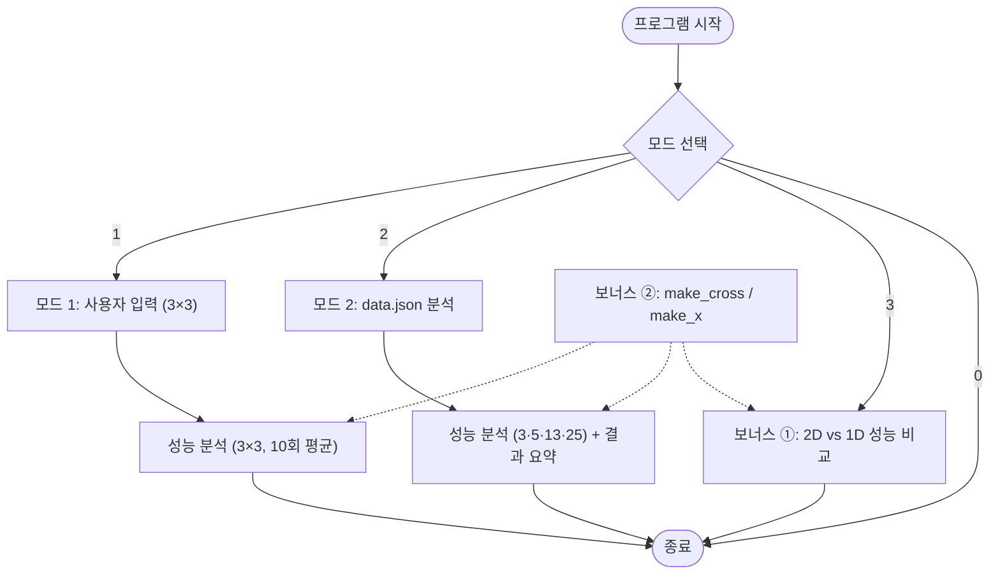
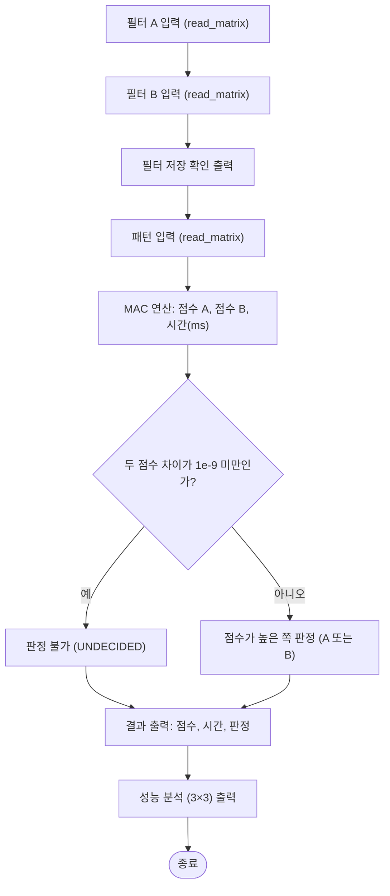
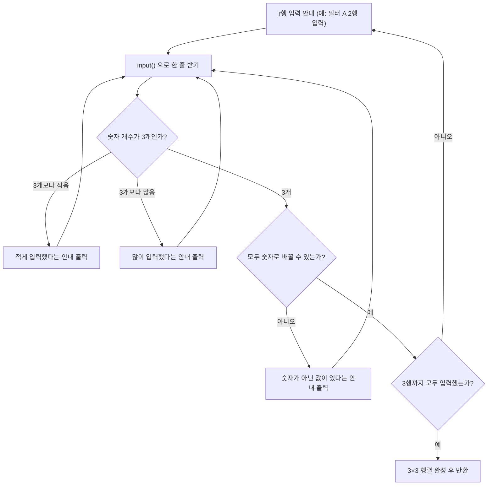
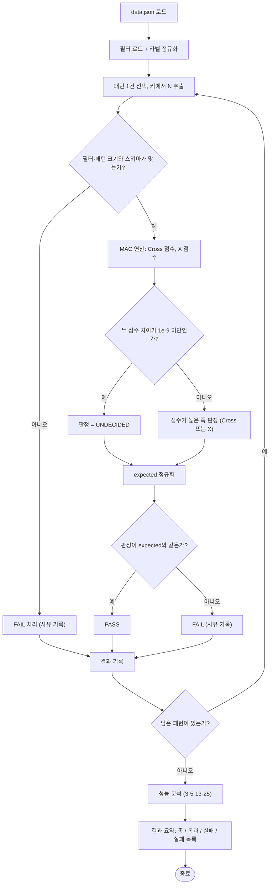
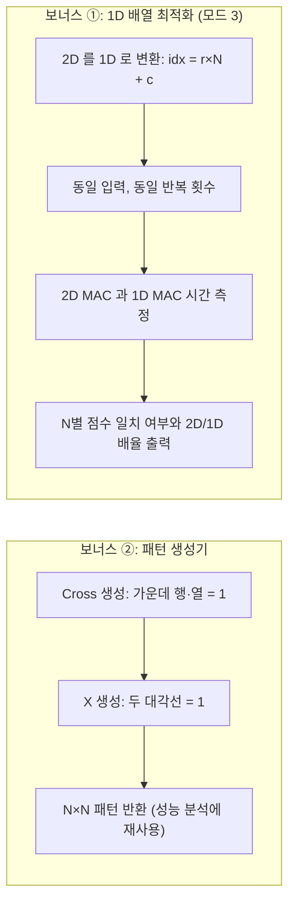
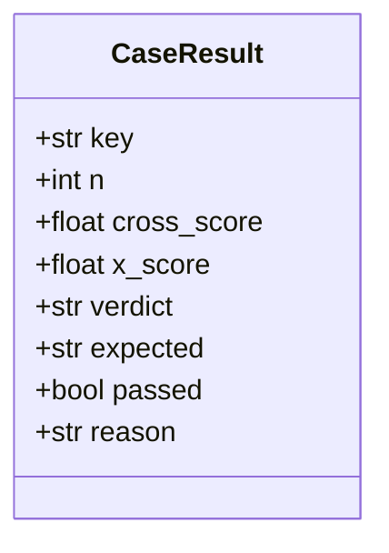
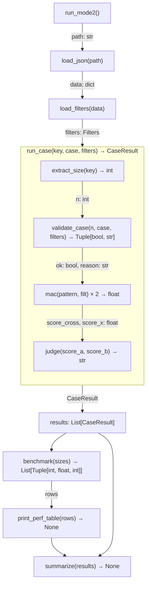
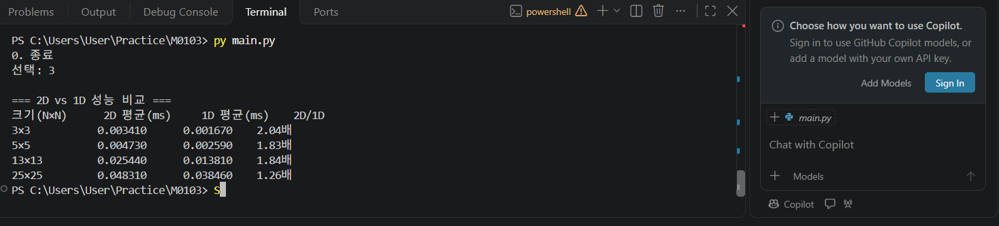

# Mini NPU 시뮬레이터 (MAC 연산)

3×3부터 25×25까지의 패턴을 필터와 비교해 Cross / X 를 판정하는 Python 콘솔 프로그램입니다.
MAC(Multiply-Accumulate) 연산을 외부 라이브러리 없이 반복문으로 직접 구현하고,
크기에 따른 연산 시간 변화를 측정해 시간 복잡도(O(N²))를 분석합니다.

---

## 1. 실행 방법

```bash
python main.py      # 환경에 따라 python3 main.py
```

| 항목 | 내용 |
|---|---|
| Python 버전 | 3.8 이상 (테스트 환경: Python 3.13) |
| 외부 라이브러리 | 없음. 표준 라이브러리(`json`, `time`, `dataclasses`, `typing`)만 사용 |
| data.json 위치 | `main.py` 와 같은 폴더 (`DATA_PATH = "data.json"`) |

**모드 선택:** 실행 후 메뉴에서 번호를 입력합니다.

| 입력 | 동작 |
|---|---|
| `1` | 모드 1: 필터 A, B 와 패턴을 직접 입력 (3×3) |
| `2` | 모드 2: `data.json` 의 모든 패턴을 판정하고 성능 분석 + 결과 요약 |
| `3` | 보너스 ①: 2D 방식과 1D 방식의 MAC 성능 비교 |
| `0` | 종료 |

**모드 1 입력 방법:** 한 줄이 1개 행입니다. 행마다 안내가 나오고, 숫자 3개를 공백으로 구분해 **한 줄씩** 입력합니다.
(여러 줄을 한꺼번에 붙여넣으면 남은 줄이 다음 입력으로 넘어갈 수 있으니 한 줄씩 입력하세요.)

```text
필터 A 1행 입력 (숫자 3개, 공백 구분): 0 1 0
필터 A 2행 입력 (숫자 3개, 공백 구분): 1 1 1
필터 A 3행 입력 (숫자 3개, 공백 구분): 0 1 0
```

---

## 2. 구현 요약

### 2-1. 라벨 정규화 방식

`data.json` 의 `expected` 는 `"+"` / `"x"` 이고, `filters` 의 키는 `"cross"` / `"x"` 로 표기가 서로 다릅니다.
그대로 비교하면 같은 뜻인데도 불일치(FAIL)가 나므로, `normalize_label()` 로 표준 라벨 `Cross` / `X` 로 통일한 뒤 비교합니다.
앞뒤 공백을 지우고 소문자로 바꾼 다음 변환하므로 `" X "`, `"Cross"` 같은 입력도 처리됩니다.
알 수 없는 라벨이 들어오면 `ValueError` 를 일으키고, `validate_case()` 가 이를 받아 **해당 케이스만 FAIL** 로 처리합니다(프로그램은 멈추지 않음).
콘솔 출력과 PASS/FAIL 비교는 모두 표준 라벨 기준입니다.

| 원본 값 | 위치 | 표준 라벨 |
|---|---|---|
| `"+"`, `"cross"`, `"Cross"` | expected / filter 키 | `Cross` |
| `"x"`, `"X"` | expected / filter 키 | `X` |
| 그 외 (예: `"o"`) | - | `ValueError` → 해당 케이스 FAIL |

### 2-2. MAC 연산 구현 개요

MAC 은 패턴과 필터의 **같은 위치끼리 곱하고, 그 값을 모두 더한** 점수입니다.
`mac()` 은 점수 변수 `total = 0.0` 을 만들고, 행(i)·열(j) 이중 `for` 문으로 모든 칸을 한 번씩 방문해
`total += pattern[i][j] * filt[i][j]` 를 누적합니다. numpy 등 외부 라이브러리나 `sum()`/`zip()` 한 줄 풀이는 쓰지 않았습니다.

손계산 예시(3×3): 십자가 패턴 `[[0,1,0],[1,1,1],[0,1,0]]` 은 1이 5칸입니다.
- 십자가 필터와는 5칸이 모두 겹쳐 `1×5 = 5.0`
- X 필터(`[[1,0,1],[0,1,0],[1,0,1]]`)와는 가운데 1칸만 겹쳐 `1.0`

모드 1에서 이 값(5.0, 1.0)이 실제로 출력되는 것을 확인했습니다.

### 2-3. 동점 처리 정책 (epsilon)

`judge()` 는 `abs(score_a - score_b) < 1e-9` 이면 동점으로 보고 `UNDECIDED` 를 돌려주고,
아니면 점수가 높은 쪽의 라벨을 돌려줍니다.

부동소수점은 아주 작은 오차가 생기므로 `==` 로 비교하면 안 됩니다. 실제로 파이썬에서
`0.1 + 0.2` 는 `0.30000000000000004` 이고 `0.1 + 0.2 == 0.3` 은 `False` 입니다.

동점이면 판정이 `UNDECIDED` 이므로 expected(`Cross` 또는 `X`)와 절대 같지 않아, 모드 2 에서는 **항상 FAIL** 이 됩니다.

### 2-4. 입력 검증 방식 (모드 1)

`read_matrix()` 는 행 번호(`필터 A 2행 입력 …`)를 안내하며 한 줄씩 입력받고, `parse_row()` 로 검증합니다.
검증 항목은 (1) 숫자 개수가 3개인가 (2) 모두 숫자로 바꿀 수 있는가 입니다.
오류는 '적게 입력' / '많이 입력' / '숫자 아님' 세 가지로 나눠 서로 다른 안내를 출력하고, **틀린 행만 다시** 입력받습니다.

행 수는 `for r in range(n)` 반복문이 3행으로 고정하므로, "행이 모자라거나 넘치는 경우"는 구조상 생기지 않는다고 해석했습니다.
(요구사항의 "행 수/열 수 불일치"는 '열 수 불일치'를 행마다 검사하는 것으로 처리했습니다.)

실제 오류 입력 예시:

```text
필터 A 1행 입력 (숫자 3개, 공백 구분): 0 1
입력 형식 오류: 숫자를 2개만 입력했습니다. 3개를 입력해 주세요.
필터 A 1행 입력 (숫자 3개, 공백 구분): 0 1 0 1
입력 형식 오류: 숫자를 4개 입력했습니다. 3개만 입력해 주세요.
필터 A 1행 입력 (숫자 3개, 공백 구분): 0 a 0
입력 형식 오류: 숫자가 아닌 값이 있습니다. 각 줄에 3개의 숫자를 공백으로 구분해 입력하세요.
필터 A 1행 입력 (숫자 3개, 공백 구분): 0 1 0
```

---

## 3. 플로차트

### 3-1. 전체 흐름



### 3-2. 모드 1: 사용자 입력 (3×3)



#### 3-2-1. read_matrix 내부: 행마다 입력 안내와 검증



### 3-3. 모드 2: data.json 분석



### 3-4. 보너스 과제



---

## 4. 함수와 자료형 설계

### 4-1. 자료형

| 이름 | 정의 | 설명 |
|---|---|---|
| `Matrix` | `List[List[float]]` | N×N 2차원 배열 (패턴, 필터) |
| `Flat` | `List[float]` | 길이 N² 의 1차원 배열 (보너스 ①) |
| `Filters` | `Dict[int, Dict[str, Matrix]]` | `{크기: {"Cross": 행렬, "X": 행렬}}` |
| `Label` | `str` | 표준 라벨: `"Cross"` 또는 `"X"` |



### 4-2. 함수 목록

| 구분 | 함수 | 받는 값 → 돌려주는 값 |
|---|---|---|
| 실행 | `main()`, `select_mode()`, `run_mode1()`, `run_mode2()` | 모드 선택과 흐름 제어 |
| 입력 | `parse_row(line, n)` | `str`, `int` → `List[float]` |
| | `read_matrix(title, n)` | `str`, `int` → `Matrix` |
| 데이터 | `load_json(path)` | `str` → `dict` |
| | `normalize_label(raw)` | `str` → `Label` |
| | `load_filters(data)` | `dict` → `Filters` |
| | `extract_size(key)` | `str` → `int` |
| | `validate_case(n, case, filters)` | → `Tuple[bool, str]` |
| 핵심 | `mac(pattern, filt)` | `Matrix`, `Matrix` → `float` |
| | `judge(score_a, score_b, label_a, label_b, eps)` | → `str` |
| | `run_case(key, case, filters)` | → `CaseResult` |
| 성능 | `measure_ms(func, *args, repeat)` | → `float` (평균 ms) |
| | `benchmark(sizes)` | → `List[Tuple[int, float, int]]` |
| | `print_perf_table(rows)`, `summarize(results)` | → `None` |
| 보너스 | `make_cross(n)`, `make_x(n)`, `flatten(m)`, `mac_flat(p, f)`, `compare_2d_1d(sizes)` | 패턴 생성, 1D 변환·연산·비교 |

### 4-3. 모드 2 함수 호출과 자료 흐름



---

## 5. 결과 리포트

### 5-1. 실행 결과 (콘솔 출력)

모드 2 (`data.json` 분석):

```text
✓ size_5 필터 로드 완료 (Cross, X)
✓ size_13 필터 로드 완료 (Cross, X)
✓ size_25 필터 로드 완료 (Cross, X)
--- size_5_1 ---
Cross 점수: 0.900000  X 점수: 0.900000  판정: UNDECIDED | expected: X | FAIL (동점(UNDECIDED) 규칙)
--- size_5_2 ---
Cross 점수: 8.900000  X 점수: 0.100000  판정: Cross | expected: Cross | PASS
--- size_13_1 ---
Cross 점수: 0.300000  X 점수: 14.700000  판정: X | expected: X | PASS
--- size_13_2 ---
Cross 점수: 7.500000  X 점수: 7.500000  판정: UNDECIDED | expected: Cross | FAIL (동점(UNDECIDED) 규칙)
--- size_25_1 ---
Cross 점수: 4.900000  X 점수: 4.900000  판정: UNDECIDED | expected: X | FAIL (동점(UNDECIDED) 규칙)
--- size_25_2 ---
Cross 점수: 52.900000  X 점수: 0.100000  판정: Cross | expected: Cross | PASS

=== 성능 분석 ===
크기(N×N)       평균 시간(ms)      연산 횟수(N²)
3×3            0.001009              9
5×5            0.001980             25
13×13          0.009754            169
25×25          0.034999            625

=== 결과 요약 ===
총 테스트: 6개  통과: 3개  실패: 3개
실패 케이스:
- size_5_1: 동점(UNDECIDED) 규칙
- size_13_2: 동점(UNDECIDED) 규칙
- size_25_1: 동점(UNDECIDED) 규칙
상세 원인 분석은 README.md 의 '결과 리포트' 참고
```

모드 1 (문서 예시: 필터 A = 십자가, 필터 B = X, 패턴 = 십자가):

```text
필터 A, 필터 B 저장 완료

필터 A 점수: 5.000000  필터 B 점수: 1.000000
필터 A 진행시간: 0.001017 ms, 필터 B 진행시간: 0.000663 ms
판정: A

=== 성능 분석 ===
크기(N×N)       평균 시간(ms)      연산 횟수(N²)
3×3            0.000676              9
```

(의도적 오류 입력 결과는 2-4 참고. 시간 값은 실행할 때마다 달라집니다.)

### 5-2. 케이스별 결과 요약

| 케이스 | Cross 점수 | X 점수 | 판정 | expected | 결과 |
|---|---|---|---|---|---|
| size_5_1 | 0.9 | 0.9 | UNDECIDED | X | FAIL |
| size_5_2 | 8.9 | 0.1 | Cross | Cross | PASS |
| size_13_1 | 0.3 | 14.7 | X | X | PASS |
| size_13_2 | 7.5 | 7.5 | UNDECIDED | Cross | FAIL |
| size_25_1 | 4.9 | 4.9 | UNDECIDED | X | FAIL |
| size_25_2 | 52.9 | 0.1 | Cross | Cross | PASS |

총 테스트: 6개 / 통과: 3개 / 실패: 3개

### 5-3. 실패 원인 분석

실패 3건(size_5_1, size_13_2, size_25_1)은 모두 **두 필터의 점수가 사실상 같아서 UNDECIDED 가 된 경우**입니다.
분류는 (c) 수치 비교 문제(동점 처리)이고, 그 배경에는 data.json 필터 값의 설계가 있습니다.
프로그램의 계산 버그가 아니라, 판정 규칙(차이가 1e-9 미만이면 UNDECIDED, UNDECIDED 는 expected 와 같을 수 없음)대로 동작한 결과입니다.

| 케이스 | 실제 점수 (파이썬 원시값) | 차이 | 점수가 같아진 이유 |
|---|---|---|---|
| size_5_1 | 0.9 / 0.8999999999999999 | 1.1e-16 | X 패턴(1이 9칸)은 Cross 필터와 가운데 한 칸(0.9)만 겹치고, X 필터와는 9칸 × 0.1 = 0.9 |
| size_13_2 | 7.499999999999997 / 7.5 | 2.7e-15 | Cross 패턴(1이 25칸)은 Cross 필터 25칸 × 0.3 = 7.5, X 필터는 가운데 값이 7.5 |
| size_25_1 | 4.9 / 4.899999999999999 | 1.8e-15 | X 패턴(1이 49칸)은 Cross 필터와 가운데 한 칸(4.9)만 겹치고, X 필터와는 49칸 × 0.1 = 4.9 |

필터의 가운데 값(0.9, 7.5, 4.9)이 일부러 두 점수가 같아지도록 세팅이 되어 있는 것 같아 보였습니다.

**epsilon 을 빼면 어떻게 되는가 (실험):** `judge()` 의 허용오차를 0 으로 바꿔 같은 점수를 비교하면 판정이 size_5_1 → Cross, size_13_2 → X, size_25_1 → Cross 로 나옵니다.
expected 는 각각 X, Cross, X 이므로 세 건 모두 여전히 FAIL 이지만, 이유가 "동점"이 아니라 부동소수점 오차로 정해진 **임의의 오판정**이 됩니다.
즉 epsilon 정책은 PASS/FAIL 개수를 바꾸지 않고, 실패 원인을 "동점"으로 정직하게 드러내는 역할을 합니다.

**개선 방법:** 규칙상 FAIL 이 맞으므로 코드는 바꾸지 않았습니다. 동점도 맞히게 하려면 동점 시 우선순위 같은 별도 규칙(요구사항 변경)이나, 두 패턴이 구분되도록 필터 값을 다시 설계하는 방법이 있습니다.
라벨 정규화는 정상 동작했습니다. 라벨 표기 차이(`+`/`x` vs `Cross`/`X`)로 인한 FAIL 은 없고, 크기·스키마 오류도 없었습니다.

### 5-4. 성능 분석



| 크기 (N×N) | 평균 시간 (ms) | 연산 횟수 (N²) |
|---|---|---|
| 3×3 | 0.003410 | 9 |
| 5×5 | 0.004730 | 25 |
| 13×13 | 0.025440 | 169 |
| 25×25 | 0.048310 | 625 |

### 5-5. 성능 해석과 시간 복잡도 (O(N²))

N 이 커질수록 평균 시간도 꾸준히 늘었습니다(0.0034 → 0.0047 → 0.0254 → 0.0483 ms).
연산 횟수 대비 시간 배율은 다음과 같습니다.

| 구간 | 연산 횟수 배율 | 측정 시간 배율 |
|---|---|---|
| 5×5 → 25×25 | 625 / 25 = 25배 | 0.048310 / 0.004730 ≈ 10.2배 |
| 5×5 → 13×13 | 169 / 25 ≈ 6.8배 | 0.025440 / 0.004730 ≈ 5.4배 |
| 13×13 → 25×25 | 625 / 169 ≈ 3.7배 | 0.048310  / 0.025440 ≈ 1.9배 |

`mac()` 은 N×N 칸을 한 번씩 방문해 곱하고 더하는 이중 반복문이므로 시간 복잡도는 O(N²) 입니다.
N 이 2배가 되면 연산량은 4배가 됩니다. 측정에서도 연산 횟수가 늘어나는 방향과 크기가 대체로 비슷하게 따라갔고, 13×13 → 25×25 구간은 배율이 거의 일치했습니다.

측정값이 이론 배율과 정확히 맞지 않는 이유는, 작은 크기에서는 한 번의 계산이 1/1000 ms 수준으로 짧아 측정 잡음과 함수 호출 같은 고정 비용의 비중이 크기 때문입니다.
같은 컴퓨터에서 `benchmark([3, 5, 13, 25])` 를 세 번 더 돌렸을 때 25×25 의 값이 실행마다 크게 달랐습니다. 그래서 한 번의 표만으로 정확한 배율을 말하기는 어렵고, "크기가 커질수록 N² 에 가깝게 늘어난다" 정도가 안전한 해석입니다.

AI 연산은 이런 MAC 을 매우 큰 행렬에서 수없이 반복합니다. 파이썬 반복문으로 순서대로 처리하면 N 이 커질수록 시간이 N² 로 늘어나므로,
같은 위치의 곱셈을 한꺼번에 처리하는 병렬 하드웨어(NPU)가 필요합니다.

---

## 6. 보너스 결과

### 보너스 ①: 2D / 1D 성능 비교 (모드 3)

2차원 배열을 `idx = r×N + c` 순서로 펼친 1차원 배열(`flatten`)에 `mac_flat` 를 적용해 같은 입력, 같은 반복 횟수(10회)로 비교했습니다. 변환 시간은 측정에서 제외했습니다.

| 크기 | 2D 평균 (ms) | 1D 평균 (ms) | 2D/1D | 점수 일치 |
|---|---|---|---|---|
| 3×3 | 0.003410 | 0.001670 | 2.04배 | 일치 (1.0) |
| 5×5 | 0.004730 | 0.002590 | 1.83배 | 일치 (1.0) |
| 13×13 | 0.025440 | 0.013810 | 1.84배 | 일치 (1.0) |
| 25×25 | 0.048310 | 0.038460 | 1.26배 | 일치 (1.0) |

이번 측정에서는 모든 크기에서 1D 가 더 빨랐습니다. 다만 실행마다 값이 크게 달라서, 같은 코드를 다른 시점에 돌렸을 때 N=5 의 배율이 14.6배, N=13 의 배율이 1.6배로 나온 적도 있습니다(N=5 의 2D 시간이 N=13 보다 컸음).
따라서 "1D 가 항상 빠르다"고 결론내리기는 어렵고, 이번 결과로는 "1D 가 대체로 빨랐지만 측정 잡음이 크다" 정도만 말할 수 있습니다.
1D 가 빠른 이유는 이중 반복문(안쪽 루프 시작 비용, 이중 인덱싱 `pattern[i][j]`)이 단일 루프와 단일 인덱싱으로 줄기 때문일 것으로 추측하지만, 확인한 것은 아닙니다.
또한 이 비교는 파이썬 기준이며, 캐시 지역성 같은 하드웨어 효과가 파이썬 리스트에서 얼마나 나타나는지는 이 실험만으로 알 수 없습니다.

### 보너스 ②: 패턴 생성기

`make_cross(n)` 은 가운데 행과 가운데 열을 1.0 으로, `make_x(n)` 은 두 대각선(`i == j` 또는 `i + j == n - 1`)을 1.0 으로 채웁니다.
짝수 N 의 가운데는 단일 칸이 없으므로, `make_cross` 는 **가운데 두 행·두 열**(인덱스 n/2 - 1 과 n/2)을 1.0 으로 정했습니다.
이 생성기는 모드 1 입력에는 연결하지 않았고, 성능 분석(`benchmark`)과 모드 3 의 테스트 데이터를 만드는 데 사용합니다.

```text
make_cross(3)      make_cross(4)      make_x(4)
0 1 0              0 1 1 0            1 0 0 1
1 1 1              1 1 1 1            0 1 1 0
0 1 0              1 1 1 1            0 1 1 0
                   0 1 1 0            1 0 0 1
```

---

## 7. 제출 전 체크리스트

- [x] `main.py` 와 `README.md` 두 파일이 있다
- [x] 외부 라이브러리(numpy, pandas 등)를 쓰지 않았다
- [x] MAC 연산을 반복문으로 직접 구현했다
- [x] 모드 1: 형식이 틀린 입력에 안내 문구가 나오고 재입력된다
- [x] 모드 2: 크기·스키마 불일치가 있어도 프로그램이 멈추지 않고 해당 케이스만 FAIL 이다
- [x] 라벨(`+`, `x`, `cross`)이 표준 라벨(Cross, X)로 정규화되어 비교된다
- [x] 동점 판정에 허용오차(epsilon)를 쓴다
- [x] 성능 분석이 크기별 10회 반복 평균으로 출력되고, 표에 크기·평균 시간·N² 가 있다
- [x] 콘솔에 총 테스트 / 통과 / 실패 수와 실패 목록이 나온다
- [x] README 에 실행 방법, 구현 요약, 결과 리포트(10줄 이상)가 있다
- [x] README 의 TODO 와 `TODO` 문구를 모두 내 내용으로 바꾸었다
